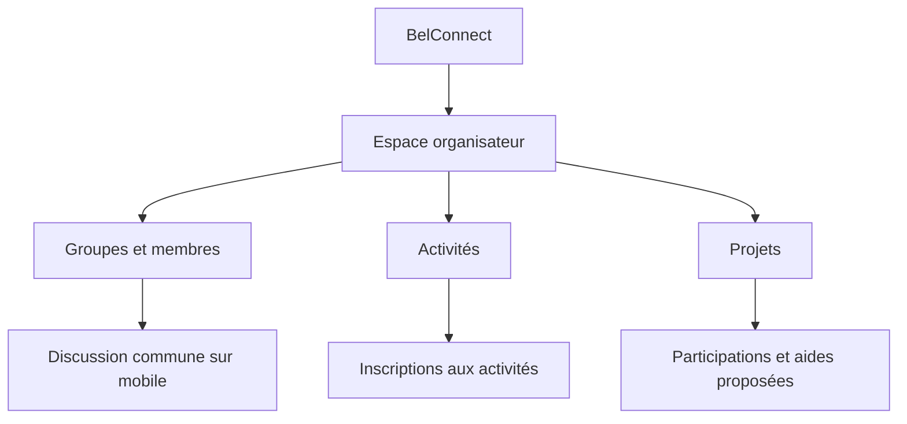
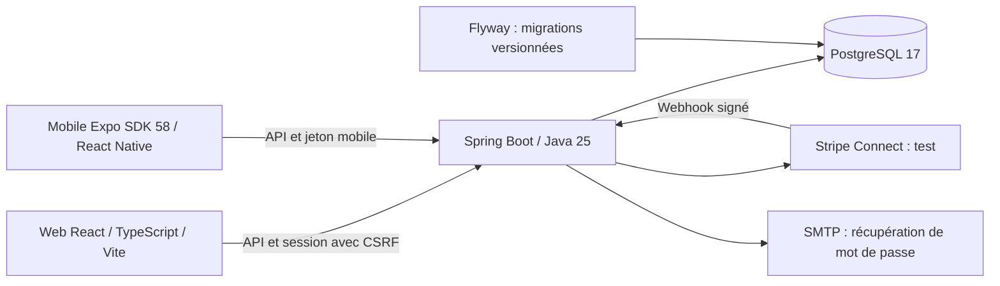

# BelConnect

Plateforme communautaire pour **organiser des activités, porter des projets et réunir des membres dans des groupes**. BelConnect propose un site web de gestion et une application mobile de participation et de communication.

**Première version de développement : `v0.1.0-alpha.1` — 31 octobre 2026.** Cette version constitue un point de sauvegarde fonctionnel, pas une certification de sécurité ni une ouverture commerciale. Les paiements restent en test et les textes de confidentialité sont à finaliser.

## Évolutions du 1er novembre 2026

- Guide organisateur accessible depuis le profil : étapes dépliables pour débuter, navigation et rôles expliqués en français, anglais et néerlandais.
- Tableau de bord : Vue d’ensemble, Mes demandes et Demandes à examiner selon les droits. Les participations personnelles sont séparées de la gestion.
- Listes compactes pour activités, projets, espaces, groupes et inscrits ; filtres et détails dépliables.
- Suivi des paiements par activité ou projet, places confirmées/restantes, commission et remboursements ; reçus Stripe personnels protégés par contrôle d’accès. Un reçu n’est pas nécessairement une facture fiscale.
- Un seul référent actif par groupe, droits limités au groupe et validation administrateur avant publication gratuite ou payante. Les tâches de gestion restent soumises aux délégations autorisées.
- Paiement d’activité vérifié en environnement Stripe de test. Paiement de projet, deuxième organisateur et remboursement complet restent à vérifier de bout en bout. Aucun encaissement réel n’est certifié.

Voir le [bilan et les prochaines vérifications](docs/BILAN_2026-11-01.md).

## Comprendre le projet

BelConnect s’adresse aux particuliers organisateurs, associations, collectifs de jeunes et autres structures souhaitant animer une communauté. Les restaurants et communes font partie des usages envisagés ; leur adéquation commerciale reste à valider. Aucun pilote géographique n’est acté dans cette documentation.

- **Membre** : découvre, rejoint des groupes, s’inscrit à des activités ou projets et échange sur mobile.
- **Organisateur / administrateur d’espace** : gère son espace, ses groupes, ses publications et leurs participants.
- **Propriétaire de la plateforme** : examine les demandes d’espace, assure la modération et suit la plateforme.

Un **espace** représente le cadre d’une organisation. Un **groupe** réunit des membres dans cet espace. Une **activité** est un rendez-vous avec des informations pratiques ; un **projet** est une initiative à construire, pouvant recevoir des participations et des propositions d’aide. S’inscrire gratuitement à un projet ne réserve pas automatiquement une place dans un voyage.



## Fonctionnalités disponibles

### Comptes et espace personnel

- Inscription, connexion, déconnexion, modification du profil et choix d’un avatar illustré.
- Récupération de mot de passe avec configuration SMTP ; validation en conditions réelles encore nécessaire.
- Tableau de bord membre : activités à venir, projets auxquels il participe et groupes rejoints.
- Rubriques structurées avec en-tête, chemin de navigation et choix horizontaux : activités, espaces, groupes, projets, demandes et participations.
- Réglages, accès aux informations de confidentialité et suppression de compte avec confirmation du mot de passe.

### Espaces et groupes

- Demande d’ouverture avec présentation, responsable, ville, public, activités envisagées et formule souhaitée.
- Suivi de la décision et modification par le demandeur tant que la demande reste en attente.
- Fiche de contrôle propriétaire, motif et historique ; correction de dossier et réexamen après refus.
- Navigation de gestion regroupée en Groupes, Projets, Paiements et Réglages.
- Création et modification de groupes, visibilité publique ou privée, adhésions et liste des membres.
- Nombre de membres souhaité facultatif et indicatif : ce champ ne bloque pas les adhésions.
- La validation d’un espace est un contrôle de la demande : elle ne certifie ni l’identité de l’organisateur ni la sécurité de ses activités.

### Activités et projets

- Catalogues, recherche, filtres et fiches détaillées ; gestion des brouillons et publications.
- Séparation entre activités organisées et inscriptions personnelles.
- Réservations gratuites d’activités, annulation selon les règles métier et restitution des places. La modification des inscriptions a été retirée de l’interface.
- Projets : brouillons, examen, approbation et publication ; le cas d’un seul administrateur actif évite l’attente de sa propre validation.
- Inscription gratuite simple à un projet publié, même sans offre payante ni dates définies.
- Propositions d’aide avec suivi distinct des projets créés par l’organisateur.
- Affichage d’une inscription existante et protection contre une seconde réservation active ; un paiement en attente est présenté séparément.
- Recherche par nom et filtres dans les participations.

### Messagerie et notifications

- Sur mobile : conversations privées et discussions communes aux membres d’un groupe, non-lus, fiche de contact, blocage, signalement et retrait d’une conversation de sa liste.
- Sur le web : consultation des membres des groupes ; la lecture des conversations reste dans l’application mobile.
- Notifications filtrables par lecture et catégorie, accès à la destination disponible, retrait des notifications lues.
- Confirmation d’inscription aux activités et de paiement pour le membre, avis aux administrateurs, avec protection contre les doublons. Le parcours équivalent des projets reste à compléter.

## Formules et modèle économique

- Un membre peut rejoindre **deux groupes au maximum**.
- **Starter, gratuit** : un espace et deux groupes par espace.
- **Pro** : deux espaces et quatre groupes par espace.
- Les groupes archivés ne comptent plus dans le plafond de groupes.
- Un administrateur Starter peut demander à passer en Pro et suivre la prise en charge. Cette demande ne déclenche ni paiement ni activation automatique.
- Abonnement organisateur et commissions constituent le modèle prévu. Les parcours Stripe Connect sont documentés séparément ; leur présence dans le code ne signifie pas que des revenus réels sont générés.

Voir [abonnements](docs/ABONNEMENT_ORGANISATEURS.md), [paiements](docs/PAIEMENTS_STRIPE.md), [participations payantes aux projets](docs/PARTICIPATION_PAYANTE_PROJETS.md) et [dons](docs/SOUTIEN_FINANCIER_PROJETS.md). Ces documents techniques peuvent décrire des étapes antérieures : les plafonds ci-dessus sont le cadrage de cette version.

## Architecture



- `frontend-web/` : interface web React et tests Vitest.
- `mobile/` : application Expo Router, connectée à l’API.
- `backend/` : API Spring Boot, sécurité, règles métier et migrations Flyway.
- `docs/` : documentation fonctionnelle, recette, paiements et conformité.
- `compose.yaml` : PostgreSQL local et Mailpit facultatif.

## Démarrage local

Prérequis : Git, Docker avec Compose, **JDK 25**, Node.js compatible avec les versions Vite et Expo du dépôt, npm. Utiliser les fichiers de verrouillage fournis avec `npm ci`.

### 1. Base de données

```bash
docker compose up -d db
```

PostgreSQL écoute sur `localhost:5433`. Les identifiants de Compose sont strictement locaux. Le volume conserve les données ; ne pas utiliser `down -v` pour un simple arrêt.

### 2. API — terminal séparé

```bash
cd backend
./mvnw spring-boot:run
```

Vérifier que `java -version` indique Java 25. Sur macOS, on peut sélectionner le JDK installé avec `export JAVA_HOME=$(/usr/libexec/java_home -v 25)` avant la commande.

API sur `http://localhost:8080`. Contrôle : `http://localhost:8080/actuator/health`. Flyway applique les migrations au démarrage. Le profil local charge des contenus fictifs signalés comme démonstration ; ils ne représentent pas des événements réels.

### 3. Web — terminal séparé

```bash
cd frontend-web
npm ci
npm run dev
```

Ouvrir l’adresse affichée par Vite, normalement `http://localhost:5173`. Le proxy transmet `/api` au backend.

### 4. Mobile — terminal séparé

```bash
cd mobile
npm ci
npx expo start --go --lan
```

Définir `EXPO_PUBLIC_API_URL` dans la configuration locale mobile avec l’adresse réseau du Mac et le port de l’API. Sur un téléphone, `localhost` désigne le téléphone, pas le Mac. Ne placer aucun secret dans une variable `EXPO_PUBLIC_*`.

Scanner le QR courant avec l’iPhone et ouvrir Expo Go ; garder le terminal ouvert et les appareils sur le même réseau. Un ancien projet de l’historique peut pointer vers une session arrêtée. Le tunnel Expo est une solution de secours pour Metro ; il ne rend pas automatiquement l’API locale accessible.

Voir aussi [le README mobile](mobile/README.md).

## Configuration et secrets

- Base hors local : `DB_URL`, `DB_USER`, `DB_PASSWORD`.
- URL du site : `APP_PUBLIC_URL`.
- HTTPS public : `SESSION_COOKIE_SECURE=true`, même origine web/API et proxy correctement configuré.
- Paiements de test : `STRIPE_SECRET_KEY`, `STRIPE_WEBHOOK_SECRET` et compte Connect organisateur prêt ; voir la documentation paiements pour les autres paramètres.
- Courriels : configuration SMTP et `MAIL_FROM` ; ne pas annoncer un envoi réel sans service configuré.

Ne jamais versionner les secrets, les fichiers d’environnement privés, les exports de données personnelles ou les QR codes temporaires. Ne pas exposer la configuration de développement telle quelle sur Internet.

## Vérifications

Avec PostgreSQL démarré et Java 25 sélectionné :

```bash
cd backend
./mvnw test
```

Les tests backend utilisent le schéma `belconnect_test` ; réserver leur configuration à une base de développement/test.

```bash
cd frontend-web
npm run lint
npm run test
npm run build
```

```bash
cd mobile
npm run lint
npx tsc --noEmit
```

Ces commandes constituent la recette à exécuter ; cette première étiquette ne signifie pas que toute la suite vient d’être rejouée. Les tests ciblés d’authentification web et mobile ont passé lors du dernier durcissement. Des échecs de navigation web ont été observés pendant les évolutions précédentes : leur résolution complète reste à confirmer dans la recette globale.

## Sécurité et confidentialité : état réel

Protections présentes : mots de passe BCrypt, contrôles serveur des comptes et des rôles, CSRF pour les sessions web, cookies HttpOnly/SameSite, jetons mobiles conservés en empreinte côté serveur, vérification des signatures de webhooks et invalidation des accès selon l’état du compte.

Le dernier durcissement couvre l’annulation des inscriptions gratuites aux projets lors de la suppression du compte, le blocage de cette suppression en présence de participations payantes en cours et la limitation des confirmations de mot de passe à cinq essais par quinze minutes. Cette limitation est en mémoire et doit être adaptée à plusieurs instances.

La suppression désactive et anonymise le profil ; elle ne supprime pas nécessairement les échanges partagés ni les pièces liées aux paiements. Les responsabilités d’administration et paiements en cours peuvent empêcher l’opération. Les durées de conservation, l’export, les contacts et les textes juridiques doivent être finalisés. **Aucun audit exhaustif, garantie d’absence de faille ou validation RGPD n’est revendiqué.**

## Prochaines étapes et première version

- [Feuille de route et critères de validation](docs/FEUILLE_DE_ROUTE.md)
- [Notes de la première version](docs/VERSION_0_1_0_ALPHA_1.md)
- [Recette web](docs/RECETTE_WEB.md)
- [Suivi conformité](docs/SUIVI_CONFORMITE.md)
- [Ancien README — historique, non normatif](docs/HISTORIQUE_IMPLEMENTATION.md)

Le tag `v0.1.0-alpha.1` fige cette étape de développement. Les futures corrections continueront après ce point ; une version prête pour le public exigera la validation des critères de la feuille de route.
