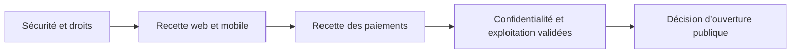

# Feuille de route BelConnect

État au 31 octobre 2026. Les éléments ci-dessous sont des travaux à réaliser ou à confirmer, pas des fonctions promises comme terminées. Priorité : fiabilité des parcours, sécurité et lisibilité, avant extension commerciale.

## 1. Sécurité et protection des membres — avant exposition publique

- [ ] Ajouter des tests dédiés à la suppression : inscriptions gratuites de projets, paiements en cours, sixième tentative, expiration de fenêtre et accès après désactivation.
- [ ] Tester les courses entre suppression et nouvelle inscription, paiement ou changement de responsabilité ; corriger les incohérences transactionnelles éventuelles.
- [ ] Rendre les limitations d’essais partagées/persistantes pour plusieurs serveurs et valider la prise en compte du proxy.
- [ ] Tester systématiquement deux comptes et deux espaces : lecture/modification de dossiers, participants, membres, messages, paiements et actions propriétaire.
- [ ] Vérifier le blocage dans les deux sens, les signalements, leur traitement, les sanctions, le spam et le contournement via invitations/groupes.
- [ ] Examiner l’exposition des coordonnées, notamment l’e-mail de contact, en fonction des accès réellement nécessaires.
- [ ] Contrôler dépendances, secrets, journaux, erreurs publiques et configuration de production.

**Critère de sortie :** scénarios de refus et d’autorisation testés, aucune faille critique connue non traitée, limites résiduelles documentées. Un signalement ne constitue pas à lui seul un dispositif complet contre le harcèlement.

## 2. Recette fonctionnelle web et mobile

- [ ] Rejouer la suite complète ; résoudre ou documenter précisément les tests de navigation en échec.
- [ ] Vérifier chaque rôle : membre, organisateur Starter/Pro et propriétaire.
- [ ] Tester adhésion, sortie, plafonds, groupe archivé et révocation d’accès.
- [ ] Tester approbation/publication et inscription aux projets, avec un ou plusieurs administrateurs.
- [ ] Vérifier les doublons d’inscription et les nouvelles tentatives après perte réseau.
- [ ] Compléter les notifications d’inscription, modification et annulation, avec liens et compteurs cohérents.
- [ ] Tester mobile installé : clavier, navigation, réseau interrompu, sessions expirées et notifications push sur appareils réels.

**Critère de sortie :** parcours reproductibles de bout en bout, y compris leurs erreurs, sans intervention manuelle en base.

## 3. Paiements — après les parcours gratuits

- [ ] Configurer Stripe test et un compte Connect de test, puis exécuter une recette complète.
- [ ] Vérifier succès, abandon, répétition, webhook retardé/dupliqué, remboursement et rapprochement des états.
- [ ] Définir puis implémenter la modification d’une participation payante et le retour au paiement ; ne pas modifier silencieusement un montant déjà payé.
- [ ] Clarifier les politiques d’annulation, les frais supportés et les remboursements selon leur initiateur.
- [ ] Vérifier l’activation, l’expiration et le changement de formule Pro ainsi que les plafonds associés.
- [ ] Valider les prix, commissions et coûts réels avant tout encaissement commercial.

**Critère de sortie :** montants et statuts cohérents entre application et prestataire, sans double débit. Les demandes de passage Pro ne valent pas abonnement payé.

## 4. Confidentialité et exploitation

- [ ] Finaliser responsable du traitement, contact, finalités, bases légales, destinataires et durées de conservation.
- [ ] Définir l’export, les demandes d’accès/rectification/effacement et les exceptions documentées à l’effacement.
- [ ] Vérifier consentements ou accusés de lecture appropriés ; ne pas confondre consultation d’une politique et consentement à tout traitement.
- [ ] Configurer HTTPS, cookie Secure, secrets distincts par environnement et accès administrateur renforcé.
- [ ] Mettre en place sauvegardes, test de restauration, alertes et procédure d’incident.
- [ ] Valider les courriels réels et les règles de conservation des journaux sans données sensibles inutiles.

**Critère de sortie :** procédures utilisables, configuration de production vérifiée et relecture juridique adaptée avant ouverture.

## 5. Produit et modèle économique

- [ ] Valider les besoins des types d’organisateurs ciblés sans présumer d’un pilote déjà décidé.
- [ ] Mesurer publications, inscriptions, retours et usage récurrent avant de multiplier les fonctionnalités.
- [ ] Documenter coûts d’hébergement, support, acquisition et traitement des paiements.
- [ ] Reprendre plus tard les graphiques propriétaire à partir de données réelles et de définitions explicites d’activité/inactivité.

Les travaux de confidentialité et d’exploitation peuvent avancer en parallèle ; le schéma représente les conditions de validation avant ouverture, pas une autorisation de publier automatiquement.
